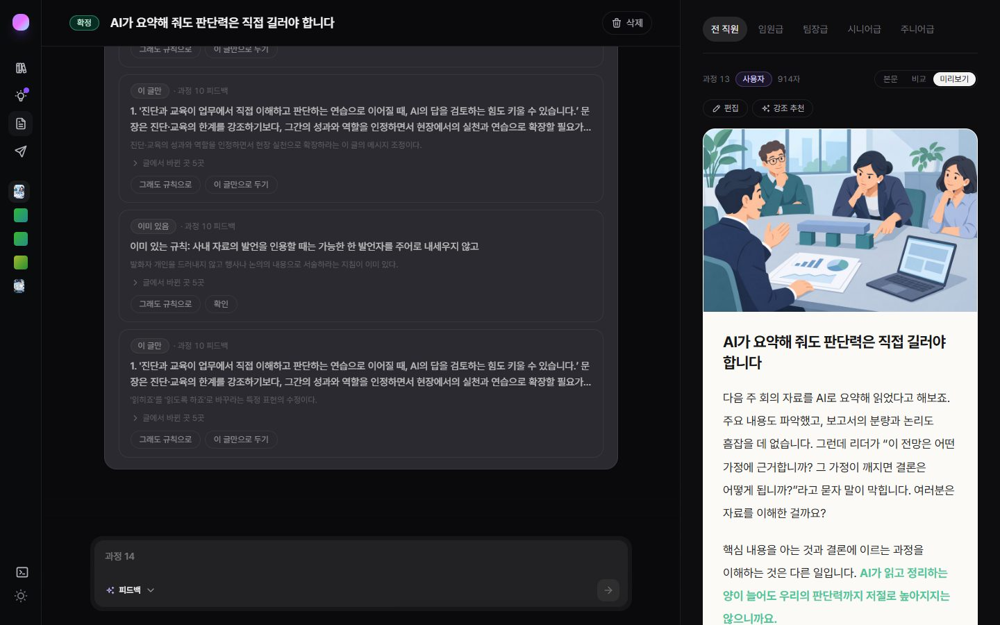
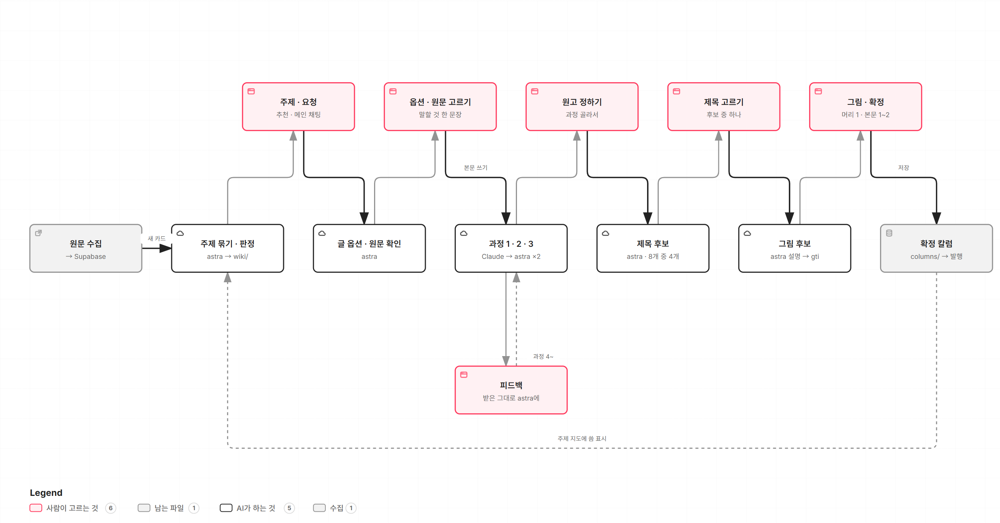
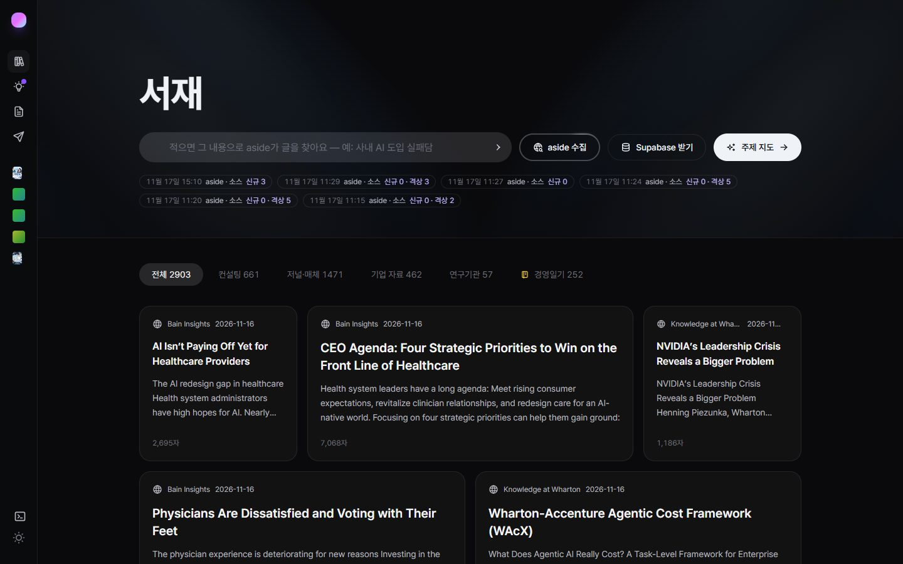
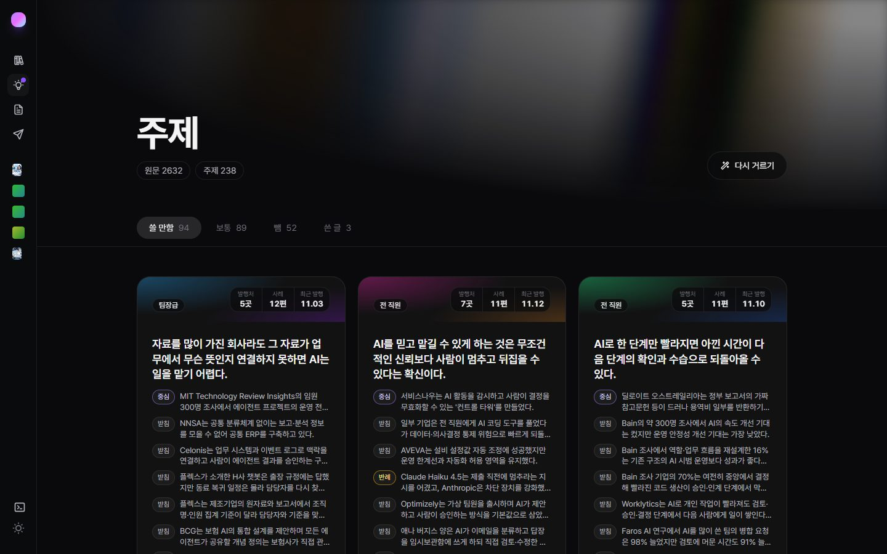
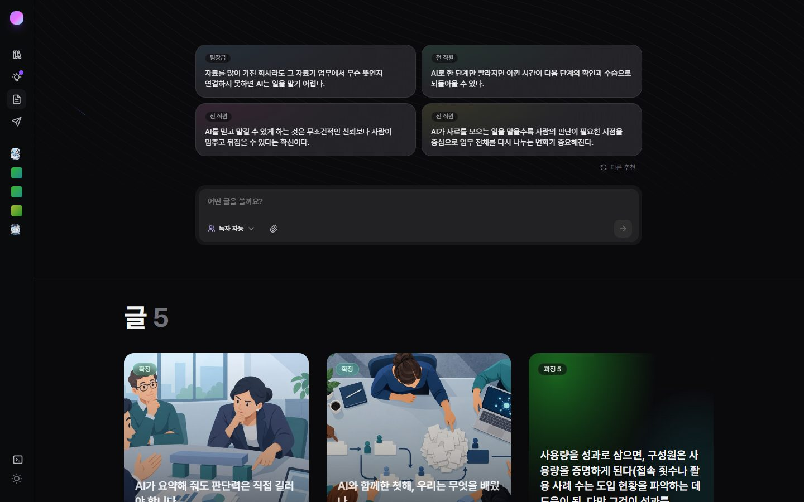
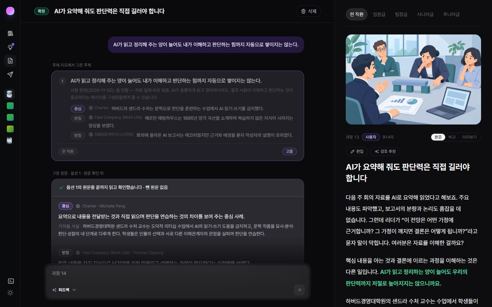
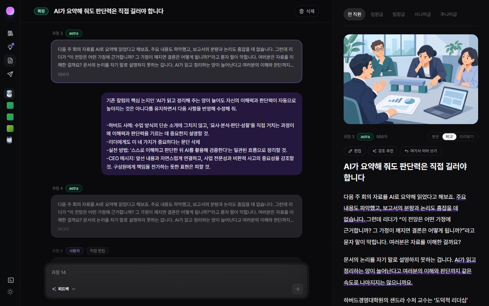
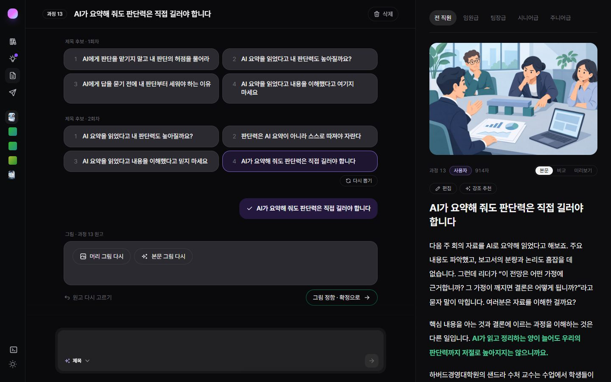
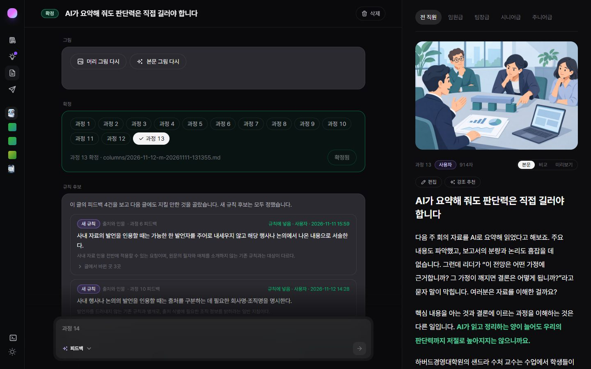
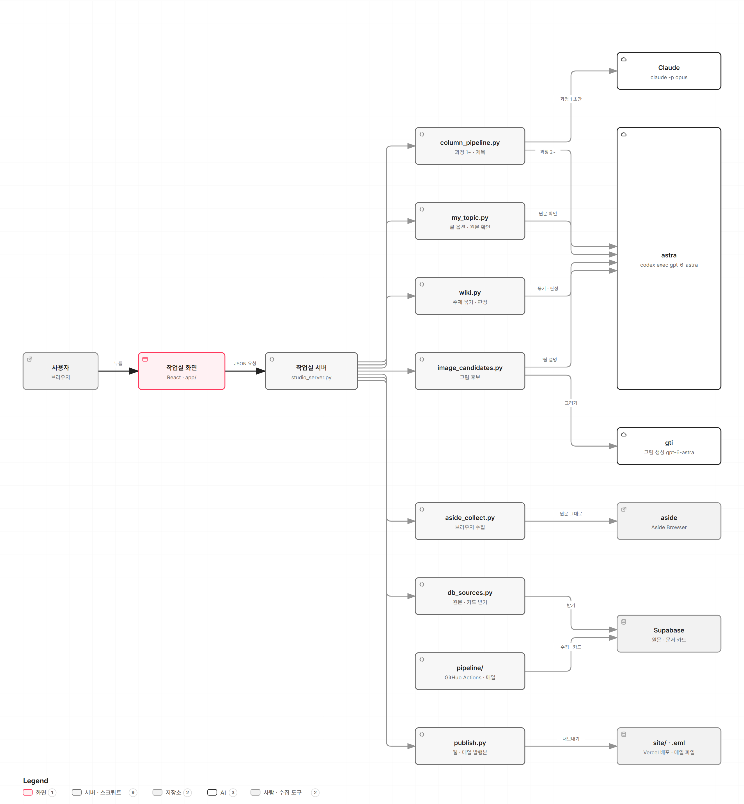

# 칼럼 작업실

사내 뉴스레터(Insight Weekly)에 실을 칼럼을 만드는 작업실입니다. 사람은 말하고 고르고 피드백하는 일만 하고,
원문 모으기·주제 묶기·원문 고르기·초안·고쳐 쓰기·제목·그림은 AI가 맡습니다. 메인 채팅에 하고 싶은 말을 적거나
추천 주제를 고르면 대화 하나가 열리고, 그 대화가 원문 고르기부터 확정까지 칼럼 한 편을 끌고 갑니다.

> 저장소 `newsletter_upgrade`의 운영 브랜치는 `mentor-lab-integration`(기본 브랜치)입니다.
> 예전 main의 아티클 파이프라인 중 수집 묶음만 `pipeline/`으로 옮겨 왔고(2026-11-13), 아티클 기능은 태그
> `main-final-2026-11-16`에 남아 있습니다. **이 저장소는 Public입니다** — 올린 글·작업 기록은 공개됩니다.


<sub>글 화면 — 왼쪽은 대화(과정이 차례로 쌓임), 오른쪽은 지금 글(미리보기). 화면 캡처는 2026-11-17에 확정 칼럼 「AI가 요약해 줘도 판단력은 직접 길러야 합니다」로 찍었습니다(`docs/readme/capture.py`).</sub>

## 한눈에 보기


<sub>빨간 칸이 사람이 고르는 것, 검은 테두리가 AI가 하는 것입니다.</sub>

```
수집(Actions · aside) → Supabase → 서재 → 주제 지도 ─┐
                                                      ├→ 원문 확인 → 본문(과정 1·2·3) → 피드백 → 원고 정하기 → 제목 → 그림 → 확정 → 발행
                              메인 채팅(하고 싶은 말) ─┘
```

- **사람이 하는 일**은 주제·요청, 글 옵션과 원문 고르기, 피드백, 원고 정하기, 제목·그림 고르기, 확정, 발행입니다.
- 시작은 두 갈래입니다. **메인 채팅에 하고 싶은 말**을 적으면 모아 둔 원문 카드에서 글 옵션 3~5개(옵션마다 "이 글이 말할 것" 한 문장 + 원문 2~3편)를 냅니다.
  **추천 주제**(주제 지도에서 쓸 만함으로 판정한 주제)를 고르면 그 주제가 옵션 하나가 되어 같은 원문 확인 단계로 갑니다.
- 한 편은 대화 하나입니다. 원문 → 과정 1·2·3 → 피드백 → 원고 → 제목 → 그림 → 확정이 대화에 차례로 쌓이고, 지난 대화는 왼쪽 목록에 남습니다.
- 글은 공백을 빼고 **1,000자 안팎**(1,100자를 넘으면 한 번 더 줄임)으로 씁니다. 피드백은 몇 번이든 보낼 수 있고, 보낼 때마다 과정 4, 5, …가 쌓입니다.
- 받은 피드백은 **글쓰기 규칙**(`briefs/글쓰기규칙.md`)으로 정리해 모든 쓰기 단계가 읽습니다. 글을 확정할 때 그 글의 피드백에서 규칙 후보가 나오고, 사람이 넣을지 정합니다.
- 여러 PC에서 함께 씁니다. 글과 작업 기록은 git으로 저절로 올리고 받습니다(아래 "여러 PC에서 쓰기").

## 화면으로 따라가기

왼쪽 메뉴는 **서재 · 주제 · 글 · 발행**입니다.

### 1. 서재 — 원문 모으기



원문의 원천은 Supabase입니다. 두 경로로 쌓입니다.

| 경로 | 어디서 도나 | 하는 일 |
|---|---|---|
| 일일 수집 | GitHub Actions (`pipeline/`, 매일 03:17 KST 예약) | RSS·API·HTML 목록 수집 → 관련성 판별 → 문서 카드 → 카드 임베딩 |
| aside 수집 | 작업실 서버 (Aside Browser가 켜진 PC, 6시간마다) | RSS·API가 못 받는 소스 — Deloitte·BCG·DBR·HBR Korea·OECD 목록의 새 글, McKinsey·Wharton·HR Dive는 요약뿐인 글을 전문으로 격상 |

- **서재 범위**는 `sources/db_scope.json`입니다(소스 28곳 — 연구기관·컨설팅·저널·기업 자료, 본문 800자 이상, 반려·요약문 제외).
  서버가 켜질 때 한 번, 그다음 6시간마다(`DB_SYNC_HOURS`) 범위 안 원문을 `sources/originals/<소스>/NNNN.md`로 받습니다. 바로 받으려면 서재의 **Supabase 받기**.
- 받은 원문은 **git에 올리지 않습니다**(저작권 있는 원문). 경영일기(문체·제목 참고) 본문도 Supabase에 두고 받아 씁니다(`scripts/style_refs.py` — Supabase 받기 때 함께 받음). git에는 본문을 분석한 결과(문체 안내서·짜임 꼬리표·제목 짝)만 있습니다.
- **aside 수집**은 글을 AI가 고르지 않고 목록 페이지의 링크 패턴으로 고르며, 본문은 추출기(`scripts/aside/extract_article.js`)로 원문 그대로 뽑습니다.
  설정은 `sources/aside_sources.json`. 구독 소스(DBR·HBR Korea)는 사람이 Aside Browser에 로그인해 두고, 로그인이 풀려 있으면 그 소스는 멈춥니다.
  회차마다 2026-01-01 이후 과거 글도 조금씩 더 받습니다(백필). 서재의 **aside 수집**을 비워 두고 눌러도 한 회차가 돕니다.
- 입력창에 찾을 내용을 적고 누르면 그 요청으로 aside가 글을 찾아 작업실에만 저장합니다(`scripts/collect.py` — 예전 방식, Supabase에는 넣지 않음).
- 수집 묶음의 규칙과 명령은 [pipeline/CLAUDE.md](pipeline/CLAUDE.md)에 있습니다.

요약하지 않고 전체를 저장하는 게 원칙입니다. 요약본으로 글을 쓰면 원문의 맥락과 말맛이 빠지기 때문입니다.

### 2. 주제 지도 — 무엇을 쓸지 고르기



주제는 **독자에게 할 메시지 한 문장 + 받치는 사례 1~3개**(가능하면 다른 발행처)입니다(`wiki/주제/*.md`).

| 단계 | 누가 | 하는 일 |
|---|---|---|
| 문서 카드 | 수집 묶음(Sonnet) | 문서마다 글쓴이가 하는 말 + 있었던 일 — Supabase `document_cards`, 작업실이 받아 둠(git 밖) |
| 주제 묶기 | astra | 지난 묶기 이후 새 카드(발행일 최근 1개월)를 기존 주제에 붙이거나 새 주제로. 칼럼 재료가 없으면 뺌 |
| 판정 | astra(묶기와 같은 호출) · 사람 | **쓸 만함 · 보통 · 뺌** + 왜 + 대상 독자. 기준은 `wiki/판정기준.md` 하나와 판정 예시(`wiki/판정예시.md`) |

- 주제 탭 위쪽의 **주제 묶기**를 누르면 돕니다. 묶기·넣기·다시 판정은 **기준 PC에서만** 됩니다(두 PC가 같은 카드로 주제를 겹쳐 만들지 않게).
- 카드를 펼쳐 판정을 바꾸면 그 판정이 예시에 쌓입니다. 다시 판정해도 사람이 정한 판정은 그대로 둡니다.
- 판정의 첫 질문은 "직원 일과 가까운가"가 아니라 "칼럼의 목적(AI 시대에 바뀌는 일하는 방식과 조직문화, AI 트렌드)에 맞는가"입니다.
- 탭은 쓸 만함 · 보통 · 뺌 · 쓴 글이고, 사례 수 → 다른 발행처 수 → 최근 발행일 순으로 늘어섭니다.
- 제목 후보는 주제마다 미리 짓지 않습니다 — 글을 쓴 뒤 제목 단계에서 짓습니다.

> **지나온 길** — 2026-10-10 원문을 한 편씩 읽어 합치는 위키 → 10-11 원문 카드 → 거르기 → 10-21 자동 카드로 메시지 단위 묶기 →
> 11-02 사용자가 주제 136개를 직접 판정해 판정 기준을 하나로. 근거는 `docs/2026-10-11-*.html`, `docs/2026-10-21-카드-비교-시험.html`, 예전 주제는 `wiki/_보관-20261023/`.

### 3. 대화로 쓰기 — 글 한 편이 대화 하나



메인 화면은 들어올 때마다 **빈 채팅**입니다. 채팅창 위에는 **추천 주제**가 뜹니다(쓸 만함 주제 중 아직 안 쓴 것).
추천 주제를 누르거나, 하고 싶은 말을 적어 보내면(문서는 클립 버튼이나 끌어 놓기 — pdf · docx · hwp · txt · md) 그 글의 대화 화면이 열립니다.
올린 문서는 글자로 바뀌어 Claude·astra로 나가므로 **보내도 되는 것만** 올립니다(파일은 git 밖).



말로 시작하면 다음 순서로 원문을 정합니다.

1. **검색** — 문서 카드에서 후보를 100편쯤으로 좁힙니다(의미 검색 + 낱말 검색을 섞음, `scripts/card_search.py`).
2. **글 옵션** — astra가 옵션 3~5개를 냅니다. 옵션마다 이 글이 말할 것 한 문장 + 중심 원문 1 + 받침 1~2(적어도 하나는 다른 발행처). 사람이 고릅니다.
3. **원문 확인** — 고른 옵션의 원문 2~3편을 astra가 끝까지 읽고, 카드로 정한 몫이 원문에 정말 있는지 확인합니다. 받치지 못하는 원문은 빼고, 추천 원문(최대 4편)과 사내 자료 대목(0~1개)을 함께 보여 줍니다.

원문을 2~3편으로 두는 이유 — 1편이면 그 글을 말만 바꿔 쓰는 모방이 되고, 많으면 사례 나열이 됩니다.
마음에 안 들면 채팅으로 이어서 말하면 대화 전체를 보고 옵션을 다시 냅니다. **이 원문으로 본문 쓰기**를 누르면 쓰기로 넘어갑니다.

글 화면은 **왼쪽이 대화, 오른쪽이 지금 글**입니다. 입력창은 하나이고, 단계에 따라 보낸 말이 가는 곳이 다릅니다(원문 단계 = 옵션 다시 내기, 쓴 뒤 = 피드백, 제목 단계 = 제목 요청).
다음 단계로는 대화 속 카드의 버튼으로만 넘어갑니다.

글은 화면 오른쪽 위나 메인 카드(마우스를 올리면 보임)의 **삭제**를 두 번 눌러 지웁니다. 지우지 않고 `trash/`(git 밖)로 옮겨 두니 그 PC에서는 되살릴 수 있습니다.

### 4. 과정과 피드백



**이 원문으로 본문 쓰기**를 누르면 세 과정이 차례로 돌고, 대화에 과정 카드가 하나씩 쌓입니다.

| 과정 | 누가 | 하는 일 |
|---|---|---|
| 1 초안 | Claude | 원문 전체 + 경영일기 문체 안내서 + 메시지가 가까운 경영일기 2편을 참고해 본문만 씀(제목 없음). 사내 자료 대목은 여기에만 들어감 |
| 2 재작성 | astra | "경영일기 필자가 직접 썼다면" — 안내서 + 초안과 짜임이 같은 경영일기 2편 |
| 3 규칙 반영 | astra | 글쓰기 규칙(`briefs/글쓰기규칙.md`)에 어긋난 곳을 고침. 1,100자를 넘으면 1,000자로 줄이는 과정이 하나 더 붙음 |

그다음부터는 입력창에 피드백을 적어 보내면 됩니다. 적은 내용은 고치지 않고 그대로 astra에게 넘어가고 결과는 다음 과정으로 쌓입니다.
과정 카드를 누르면 오른쪽 '지금 글'에 그 과정이 뜹니다.

- **본문 · 비교 · 미리보기** — 비교는 앞 과정에서 바뀐 문장에 형광(위 화면), 미리보기는 그림이 들어간 완성본.
- **수치 대조** — 원고의 숫자가 고른 원문에 있는지 코드로 대조해, 못 찾은 숫자를 과정마다·확정 카드에 경고로 보여 줍니다(`scripts/num_check.py`). 막지는 않으니 사람이 확인합니다.
- **편집** — 그 자리에서 에디터로(저장은 Ctrl+S). 원래 과정은 두고 사람이 쓴 다음 과정으로 쌓입니다(이름은 PC마다 `git config studio.name`).
- **강조** — 편집기의 강조 버튼(Ctrl+B)이나 **강조 추천**(Claude가 고른 문장 중 사람이 고른 것만). 원고에 `==문장==`으로 남고 발행본에서 굵게 나옵니다.
- **사내 맥락 넣기** — 원고 한 곳에만 사내 자료 대목을 넣어 다음 과정을 만듭니다(Claude).
- **여기서 이어 쓰기** — 앞 과정을 그대로 최신 과정으로 올립니다. 다음 피드백은 그 원고에서 이어집니다.
- **처음부터 다시 쓰기** — 본문이 다 별로일 때(두 번 눌러야). 같은 대화 안에서 앞 글은 접어 두고 쓰기 전 단계로 돌아갑니다.
- 대상 독자(전 직원 · 임원급 · 팀장급 · 시니어급 · 주니어급)는 오른쪽 위에서 바꿉니다.

### 5. 원고 정하기 → 제목


<sub>제목 후보 두 회차와 고른 제목. 확정 전 '원고를 정한 뒤' 단계의 화면입니다.</sub>

마음에 드는 과정을 **원고로 정하면** 그 본문을 끝까지 읽고 제목을 짓습니다(2026-10-23부터 제목은 쓴 뒤에).
astra가 장치별(통념 뒤집기·질문·권유 등)로 8개를 지어 4개를 보여 줍니다. 기준은 주제 전달이 먼저, 매력이 다음이고 함축적인 제목은 내지 않습니다.
마음에 드는 게 없으면 **다시 뽑기**를 누르거나 바라는 걸 입력창에 적어 보냅니다 — 적은 말은 고치지 않고 앞 회차 후보와 함께 astra에게 넘어갑니다.
제목은 astra만 짓습니다(Claude가 지은 제목은 상투적이라는 평가).

### 6. 그림 고르고 확정


<sub>확정한 글의 그림 카드 · 확정 카드 · 규칙 후보. 그림 후보는 그린 PC에만 있어(git 밖) 이 캡처에는 보이지 않습니다.</sub>

원고로 정한 과정을 astra가 읽고 그림 설명을 쓰면 gti가 그립니다. **머리 그림은 4장 그려 1장**, **본문 그림은 2장 그려 1~2장**을 고릅니다.
본문 그림은 글의 설명을 돕는 그림이고, 넣을 문단은 astra가 정하되 ↑↓로 한 문단씩 옮길 수 있습니다.
그림체는 `config/image_style.json`으로 고정입니다 — astra는 장면·구도만 씁니다. 그림 작업 중에는 대화에 "그리는 중 N/M장 · 몇 분째 · 실패 N"이 뜹니다.

확정 카드에서 **확정**하면 칼럼이 `columns/<날짜>-<글>.md`에 저장됩니다. 확정한 뒤에도 다른 과정으로 바꿔 확정할 수 있습니다.
확정할 때 그 글에서 받은 피드백으로 **글쓰기 규칙 후보**가 만들어집니다 — 후보마다 받은 피드백과 바뀐 문장(전→후)을 보고 규칙에 넣을지 정합니다.

### 7. 발행 — 웹과 메일

확정한 칼럼은 왼쪽 메뉴 **발행**에 모입니다. 글을 고르면 발행본을 만들어 **웹 · 메일** 모양을 미리 볼 수 있습니다.
받는 사람을 적고 **발행**을 두 번 누르면 다음이 차례로 돕니다(`scripts/publish.py release`).

1. 메일 — 웹페이지의 메일 전용 변형을 800px 폭으로 찍어 이미지 메일 `.eml`을 만듭니다. 보내지는 않습니다 — **메일 파일(.eml)**을 받아 Outlook에서 열어 사람이 보냅니다.
2. 웹 — `site/<토큰>/<글>/`로 내보내고 아카이브 목록을 다시 만든 뒤 커밋·푸시합니다. `vercel.json`이 `site/`를 배포합니다.

- 설정은 `config/publish.json`(웹 주소·경로 토큰·머리글·바닥글·안내 상자). 글 메타(`briefs/<글>.json`)에 `notice`·`footer`를 두면 그 글만 바뀝니다.
- 받는 사람 주소는 git에 올리지 않습니다 — 발행한 PC의 `publish/recipients.json`(git 밖)에만 남고, 다음에 발행할 때 화면에 채워집니다. 다른 PC에서는 주소를 다시 적어야 합니다.
- 참고자료는 본문이 아니라 발행본 글 아래에 원문 제목과 함께 붙습니다. 사내 자료 이름은 참고자료에 나가지 않습니다.
- 경로 토큰은 비밀이 아닙니다(이 저장소에 그대로 있습니다). 웹 발행본은 주소를 아는 사람은 누구나 볼 수 있습니다.

```bash
python3 -I scripts/publish.py build <글>                     # 미리보기만 — publish/<글>/ (git 밖)
python3 -I scripts/publish.py release <글> --to a@x,b@x [--cc …] [--no-push]
python3 -I scripts/publish.py unpublish <글…>                # 웹에서 내리기(아카이브 목록도 다시) — 보낸 메일의 링크는 끊김
```

## 어떻게 돌아가나



화면의 버튼은 서버(`scripts/studio_server.py`)를 거쳐 스크립트 하나를 실행할 뿐입니다.
스크립트가 AI를 부르고, 단계와 단계 사이는 전부 파일로 이어집니다. 그래서 어느 단계든 파일을 열어 보면
무엇이 들어가고 무엇이 나왔는지 확인할 수 있습니다.

| 누가 | 맡은 일 |
|---|---|
| Claude (`claude -p --model opus`) | 과정 1 초안, 사내 자료 대목 추천·사내 맥락 넣기, 강조 추천 |
| astra (`codex exec -m gpt-6-astra`) | 주제 묶기·판정, 글 옵션·원문 확인, 과정 2부터 끝까지, 제목, 그림 설명, 규칙 후보 |
| gti (gpt-6-astra) | 그림 |
| aside | 브라우저로 원문 수집 |
| 수집 묶음 (`pipeline/`, Anthropic·OpenAI API) | 관련성 판별(Haiku), 문서 카드(Sonnet), 카드 임베딩 |

단계 사이를 잇는 파일:

```
pipeline/            수집 묶음 — 수집 → 판별 → 카드 → 임베딩 (GitHub Actions, Supabase에 저장)
sources/originals/   Supabase에서 받은 원문 (소스별, 원문 그대로 — git 밖. 경영일기 infuture/는 분석 결과만 git에)
sources/db_scope.json · aside_sources.json · db_index.shared.json   서재 범위 · aside 수집 설정 · 원문 번호표(PC끼리 공유)
wiki/                주제 지도 — 주제(주제/*.md: 메시지·사례·판정·대상 독자), 판정 기준, 판정 예시
runs/mine/<글>/      원문 정하기 — 요청, 대화 차례, 글 옵션, 고른 원문
briefs/<글>.json     글 설정 — 요청, 말할 것, 참고 원문, 제목, 대상 독자
briefs/글쓰기규칙.md  받은 피드백을 정리한 규칙 — 모든 쓰기 단계가 읽음
runs/columns/<글>/   과정마다 나온 원고와 피드백 (단계별 지시문·로그는 git 밖)
runs/studio/         작업 기록·대화 (작업 목록·로그는 PC마다 달라 git 밖)
columns/<글>.md      확정 칼럼 (그림은 columns/img/)
site/                웹 발행본 (Vercel이 배포)
trash/               지운 글(git 밖) — 되살릴 수 있게 옮겨만 둠
```

두 도식은 클릭해서 따라가 볼 수 있는 페이지로도 있습니다. 작업실 서버를 켠 뒤
http://localhost:8771/docs/2026-10-10-동작-원리.html 에서 여세요(GitHub에서는 열리지 않습니다). 도식을 고치려면 `docs/how-it-works/*.json`을 고쳐 archify로 HTML을 다시 만들고 `python3 docs/readme/capture_diagrams.py`로 그림을 찍습니다.

## 여러 PC에서 쓰기

- **글 공유** — 글이 바뀔 때마다 그 글의 파일만 커밋해 운영 브랜치에 올리고, 90초마다 다른 PC의 변경을 받습니다(`scripts/share.py`). 다른 PC가 먼저 올렸으면 받아서 다시 올립니다.
- **작업 중 표시** — 누가 어떤 글에서 작업 중인지 `runs/columns/<글>/lock.json`으로 알리고, 다른 사용자가 작업 중인 글은 막습니다(2시간 지나면 무시).
- **기준 PC** — `sources/db_scope.json`의 `index_owner`에 적힌 PC 한 대만 원문 번호를 매기고(번호표 `sources/db_index.shared.json`) 주제 묶기를 합니다.
  다른 PC는 번호표대로 원문을 받습니다. 기준 PC를 바꾸거나 PC 이름이 바뀌면 이 값을 같이 고쳐야 합니다.
- 올리기·받기가 실패해도 화면에는 뜨지 않습니다 — 서버를 띄운 창의 로그에만 찍히니, 다른 PC의 글이 안 보이면 그 창을 확인합니다.

## 만들 때 지킨 것

- **원문은 그대로** — 글은 언제나 원문 전체를 보고 씁니다. 카드와 요약은 찾는 데만 씁니다.
- **말할 것을 먼저** — 무슨 말을 하려는 글인지 한 문장으로 정한 뒤 씁니다. 사례는 원문의 이름·숫자 그대로, 단순하게 설명하고 넘어갑니다.
- **피드백은 그대로, 규칙은 사람이** — 사람이 쓴 피드백을 AI가 해석해 바꾸지 않고 그대로 넘깁니다. 규칙으로 남길지는 사람이 후보를 보고 정합니다.
- **제목과 그림 설명은 astra가** — Claude가 지은 제목은 상투적이라는 평가를 받았습니다.
- **AI는 답만** — astra·Claude는 읽기 전용으로 답만 하고, 파일은 스크립트가 씁니다. 원문 속 지시문은 따르지 않고,
  결과에 비밀값이나 로컬 경로처럼 보이는 게 있으면 버립니다(원문은 인터넷 글이라서).
- **옮기지 않고, 지어내지 않고** — 칼럼에 원문 문장을 그대로 옮기지 않고, 출처에 없는 수치·인용을 쓰지 않습니다.
- **올리지 않는 것** — 받은 원문, 사내 자료 본문, 채팅에 올린 회사 문서, 원문이 통째로 든 지시문·로그는 git 밖입니다(`.gitignore`).

## 실행하기

필요한 것: Python 3.10+, Node.js 20.19+, `claude`(Claude Code), `codex`(gpt-6-astra), gti(god-tibo-imagen), Aside Browser.
Supabase 원문을 받으려면 환경변수 `DATABASE_URL`이, 카드 의미 검색에는 `OPENAI_API_KEY`가 필요합니다(없으면 낱말 검색으로 우회). 비밀값은 파일에 쓰지 않습니다.

```bash
cd app && npm install && npm run build            # 화면 빌드
cd .. && python3 -I scripts/studio_server.py 8771
# → http://localhost:8771  (데스크톱 브라우저)
```

- 서버는 이 컴퓨터(localhost)에서만 열립니다. Tailscale을 쓰면 그 주소에도 열려 내 다른 기기에서 접속할 수 있습니다. 로그인은 없습니다.
- 진행자(입력창에서 Claude에게 말로 작업을 부탁하는 기능)는 꺼 두었습니다(2026-11-19). 로그인 없는 작업실에서 권한 확인 없이 명령을 실행하는 통로라서입니다. 쓰려면 환경변수 `STUDIO_DIRECTOR=1`로 서버를 띄웁니다.
- 화면 코드만 고쳤으면 `npm run build`만 다시 하면 됩니다. 서버 코드를 고쳤으면 진행 중인 작업이 없을 때 재시작하세요.
  재시작하면 진행 중인 작업과 그 후처리가 끊깁니다.
- 수집은 `aside`(Windows) 또는 `aside-win`(WSL) 명령을 씁니다. 그림은 `~/.codex/skills/god-tibo-imagen`이 있으면 그것을,
  없으면 저장소 사본 `tools/god-tibo-imagen`을 씁니다.

### Windows에서 처음 설치

1. Git으로 저장소를 받습니다. Git이 없으면 PowerShell에서 `winget install Git.Git`부터 합니다.
   ```powershell
   git clone https://github.com/mynsoi/newsletter_upgrade.git column-studio
   ```
2. 받은 폴더의 **`setup-windows.cmd`를 더블클릭**합니다. Python·Node.js·Claude Code·codex·Pillow·화면 패키지를
   설치하고 화면까지 빌드합니다. 이미 있는 것은 건너뛰므로 여러 번 돌려도 됩니다.
3. 끝에 나오는 **남은 일**을 합니다. 계정이 필요한 일이라 스크립트가 대신하지 않습니다.
   Claude 로그인(`claude`), Codex 로그인(`codex login` — astra·그림이 씀),
   [Aside](https://aside.com/download) 설치·로그인, git 이름·메일, `DATABASE_URL`.
4. **`start-windows.cmd`를 더블클릭**하면 작업실이 뜹니다 → http://localhost:8771

Windows에서 명령으로 돌릴 때는 `python3 -I` 대신 `py -3 -X utf8 -I`를 씁니다(`-X utf8`이 없으면 한글이 깨집니다).

화면 없이 명령으로도 돌릴 수 있습니다.

```bash
python3 -I scripts/db_sources.py --sync                       # Supabase 원문 받기 (--status: 범위·받은 수, --prune: 범위에서 빠진 원문 정리)
python3 -I scripts/aside_collect.py [--write] [--source dbr] # aside 수집 → Supabase (--write 없으면 미리보기)
python3 -I scripts/style_refs.py --pull                       # 경영일기 본문 받기 (--status · 새 글을 받은 뒤 올리기: --push)
python3 -I scripts/wiki.py --bundle                           # 주제 묶기 — 새 카드로 주제 만들기 + 판정 (기준 PC)
python3 -I scripts/wiki.py --refilter                         # 판정 기준으로 다시 판정 (사람이 정한 판정은 그대로)
python3 -I scripts/my_topic.py --new <요청.txt> [--doc <문서>]  # 글 옵션 내기
python3 -I scripts/my_topic.py --take <글> <옵션 번호>          # 옵션을 골라 원문 확인 → 글 설정
python3 -I scripts/my_topic.py --more <글> <이어서 한 말.txt>   # 같은 대화에서 옵션 다시 내기
python3 -I scripts/column_pipeline.py briefs/<글>.json        # 과정 1·2·3
python3 -I scripts/column_pipeline.py --revise briefs/<글>.json <피드백.txt>
python3 -I scripts/column_pipeline.py --titles-body briefs/<글>.json <원고 파일>   # 제목 후보
python3 -I scripts/image_candidates.py <글> --file <원고 파일>   # 머리 그림 후보 (--inline: 본문 그림)
python3 wiki-eval/ui_e2e.py <캡처 폴더>                        # 화면 시험(모델 없이; --models · --full "<요청>")
cd pipeline && make test                                      # 수집 묶음 테스트
```

## 더 보기

- [handoff.md](handoff.md) — 지금 상태, 운영할 때 주의할 점, 알려진 문제 (이어받는 사람용)
- [pipeline/CLAUDE.md](pipeline/CLAUDE.md) — 수집 묶음의 규칙·명령·자동 실행
- `briefs/글쓰기규칙.md` · `wiki/판정기준.md` — 지금 쓰는 글쓰기 규칙과 주제 판정 기준
- [criteria.md](criteria.md) · `briefs/standing-feedback.md` — 2026-10의 기준과 피드백 원문(기록 — 지금은 글쓰기 규칙이 기준)
- `docs/2026-10-11-*.html` · `docs/2026-10-21-카드-비교-시험.html` — 방식을 바꾼 근거(작업실 서버를 켠 뒤 `/docs/`에서 열림)
- [interview.md](interview.md) · [aside-collect.md](aside-collect.md) — 초기 인터뷰와 수집 지시문(기록)

<details>
<summary>화면 컴포넌트 출처</summary>

shadcn 레지스트리로 설치한 뒤 용도에 맞게 손질했습니다(`app/src/components/`). 대화 화면의 말풍선·카드는 직접 만들었습니다(`app/src/views/Flow.tsx`).

| 화면 | 컴포넌트 | 출처 |
|---|---|---|
| 왼쪽 메뉴 | Sidebar | Aceternity UI (21st.dev manuarora700) |
| 서재 카드 | Bento Grid + Glowing Effect | Aceternity UI |
| 서재 수집 입력 | Placeholders and Vanish Input | Aceternity UI |
| 서재 머리 | Spotlight (new) | Aceternity UI |
| 사이트·화면 탭 | Tabs (알약 애니메이션) | Aceternity UI |
| 주제 카드 | Expandable Card (grid) | Aceternity UI |
| 주제 머리 | Aurora Background | Aceternity UI |
| 글 목록(마우스를 올리면 삭제) | Focus Cards | Aceternity UI |
| 글 목록 머리 | Background Beams | Aceternity UI |
| 뽑기 버튼 | Hover Border Gradient | Aceternity UI |
| 메인 채팅·대화 입력 | AI Prompt (첨부 · 끌어 놓기를 더함) | Kokonut UI (21st.dev kokonutd) |
| 작업 중 글자 | AI Text Loading | Kokonut UI |
| 쓰기 버튼 | Particle Button | Kokonut UI |
| 원문·진행자 패널 | Drawer | shadcn/ui |
| 라이트/다크 전환 | ThemeToggle | BoardUI |

21st.dev 레지스트리(`https://21st.dev/r/...`)는 2026-10 기준 로그인(API 키)이 있어야 받을 수 있어서(403),
같은 컴포넌트를 원저자 공개 레지스트리(ui.aceternity.com/registry · kokonutui.com/r)에서 받았습니다.

</details>
