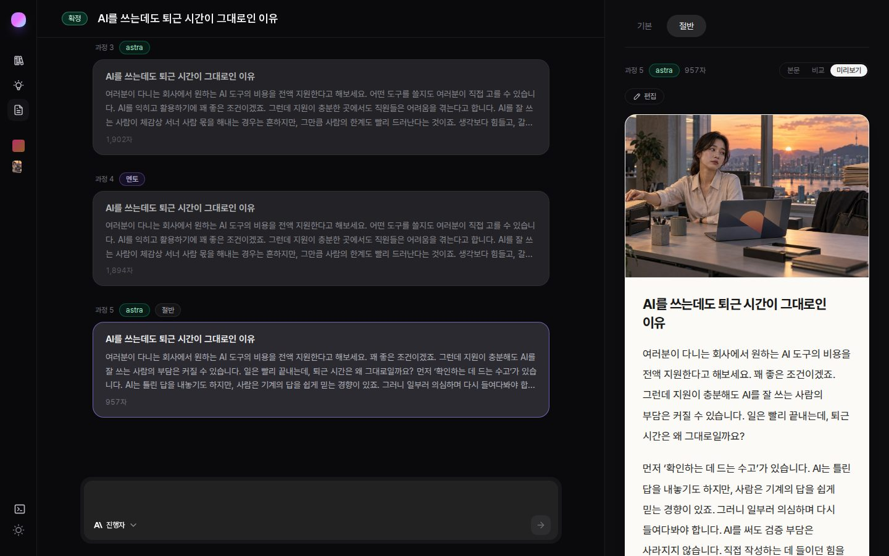
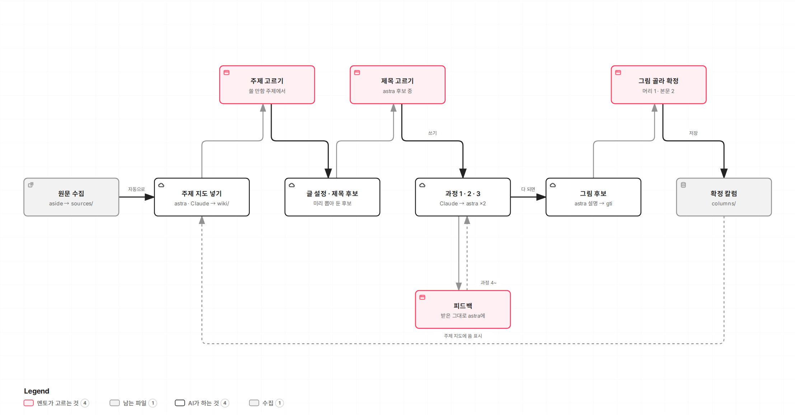
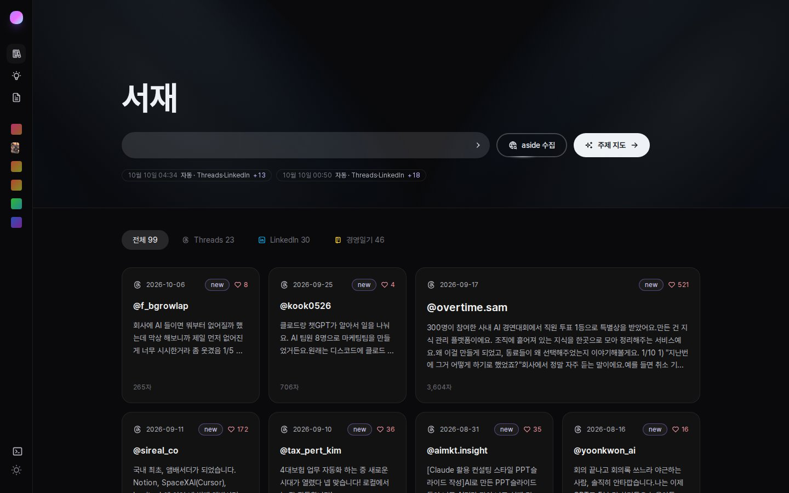
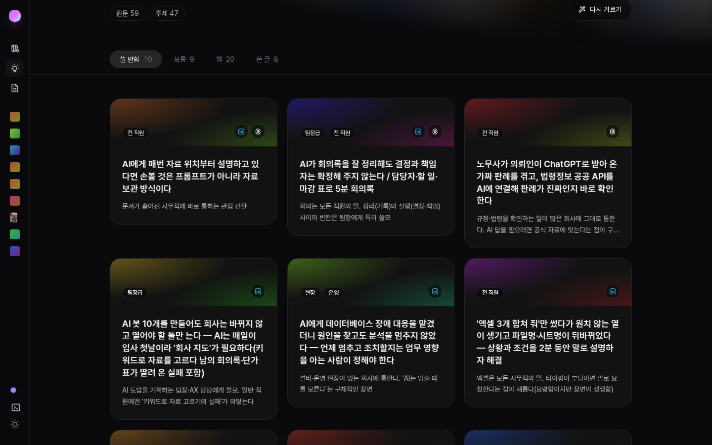
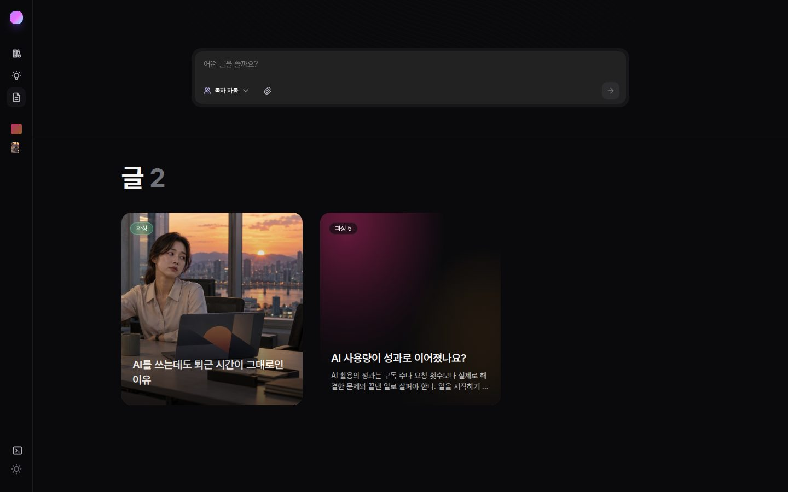
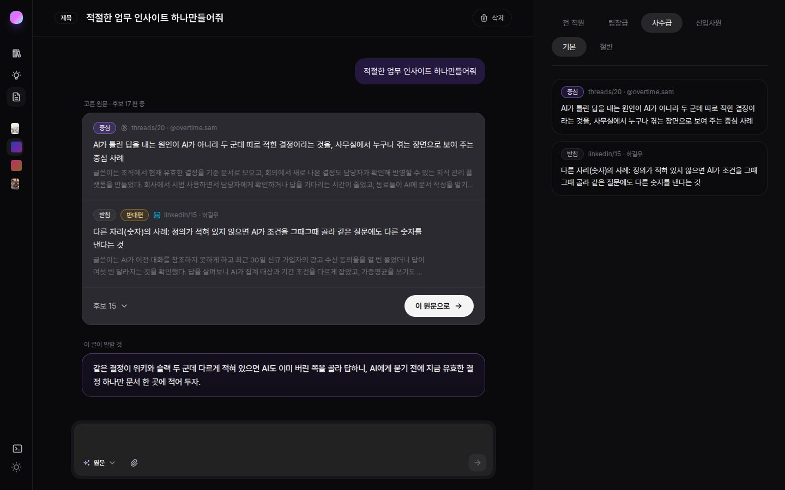
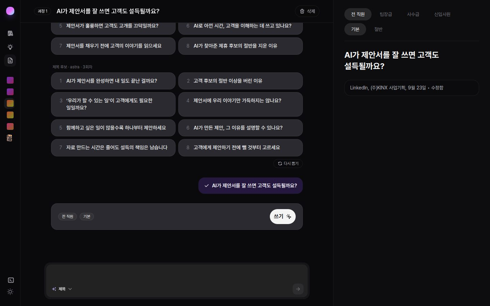
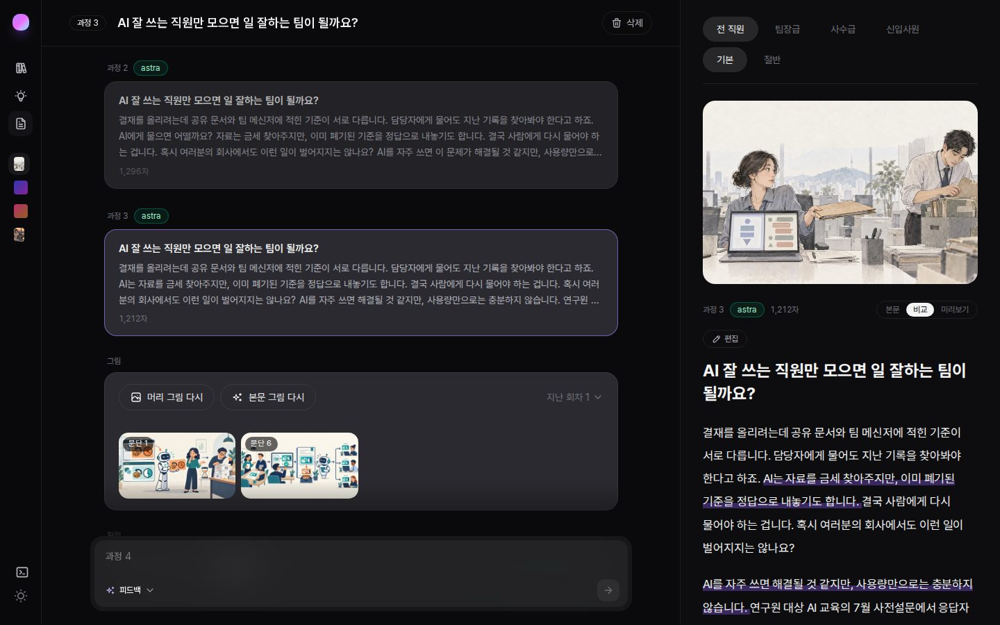
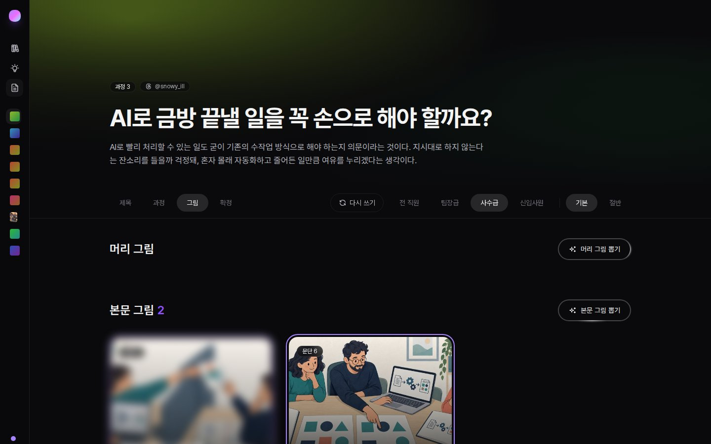
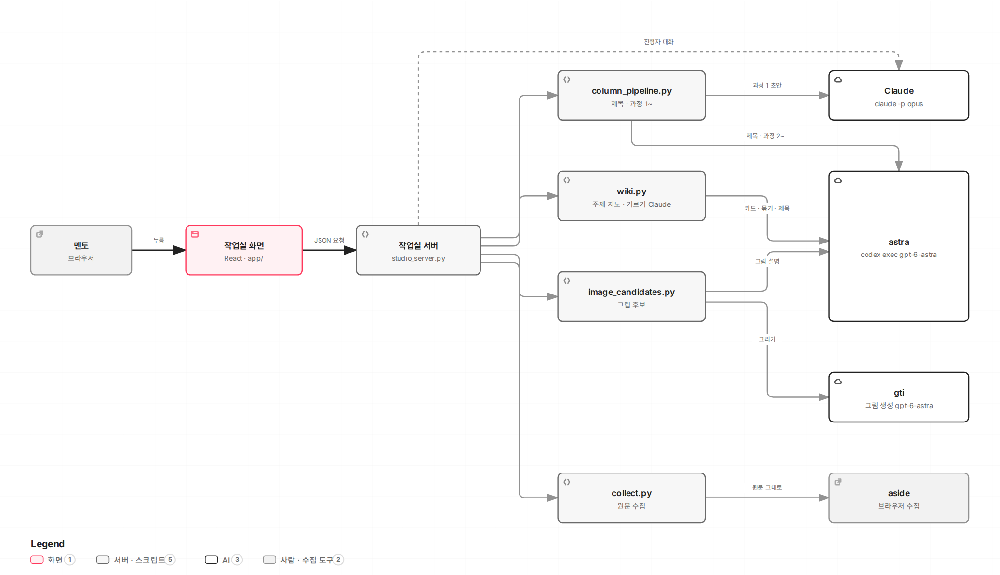

# 칼럼 작업실 (mentor-lab)

사내 뉴스레터에 실을 칼럼을 만드는 작업실입니다. 사람은 말하고 고르고 피드백하는 일만 하고,
원문 모으기·주제 정리·원문 고르기·초안·고쳐 쓰기·그림은 AI가 맡습니다. 메인 채팅에 하고 싶은 말을 적거나
추천 주제를 고르면 대화 하나가 열리고, 그 대화가 원문 고르기부터 확정까지 칼럼 한 편을 끌고 갑니다.

> 팀 저장소(`newsletter_upgrade`)의 아티클 파이프라인과는 따로, 멘토가 직접 쓰는 방식을 시험하려고 만든 저장소입니다.
> 팀 방식의 문체 지침·루브릭·증거 게이트는 쓰지 않습니다.


<sub>글 화면 — 왼쪽은 대화(과정이 차례로 쌓임), 오른쪽은 지금 글(미리보기). 확정한 칼럼 「AI를 쓰는데도 퇴근 시간이 그대로인 이유」</sub>

## 한눈에 보기



- **빨간 칸만 사람이 합니다.** 주제·요청, 제목 고르기, 피드백, 그림 골라 확정까지 네 가지입니다.
- 시작은 두 갈래입니다. **메인 채팅에 하고 싶은 말**을 적으면 Claude가 모아 둔 원문에서 그 말을 보여 줄 원문과
  "이 글이 말할 것" 한 문장을 고릅니다. **추천 주제**(주제 지도에서 쓸 만하다고 거른 주제)를 고르면 미리 뽑아 둔 제목 후보가 바로 뜹니다.
- 한 편은 대화 하나입니다. 원문 → 제목 → 과정 1·2·3 → 피드백 → 그림 → 확정이 대화에 차례로 쌓이고, 지난 대화는 왼쪽 목록에 남습니다.
- 멘토가 지난 글들에 한 말(`briefs/standing-feedback.md`)은 받은 그대로 초안·재작성·기준 반영 모든 과정에 들어갑니다.
- 글은 공백을 빼고 1,500자 이하로 씁니다. 피드백은 몇 번이든 보낼 수 있고, 보낼 때마다 과정 4, 5, …가 쌓입니다.

## 화면으로 따라가기

### 1. 서재 — 원문 모으기

> **2026-10-20 — 주제 재료를 Supabase로 바꿈.** Threads·LinkedIn 샘플 원문은 지웠고, 주제 재료는 팀 파이프라인(main)이
> 매일 모으는 Supabase 문서에서 받아 옵니다. 범위는 `sources/db_scope.json`(소스 28곳 — 컨설팅·저널·기업 자료·연구기관,
> 본문 800자 이상, 반려·요약문·초록·뉴스 제외)이고, `python3 -I scripts/db_sources.py --sync`가 원문 그대로
> `sources/originals/<소스>/NNNN.md`로 내려 둡니다(git 밖 — 저작권 있는 원문이라 저장소에 올리지 않음, `DATABASE_URL` 필요).
> 서재 탭은 등급별(컨설팅 · 저널·매체 · 기업 자료 · 연구기관)로 묶입니다. 경영일기는 주제 재료가 아니라 과정 1·2의 **문체 참고**라 그대로 둡니다.
> 주제 지도 넣기는 한 번에 최근 글 40편까지(`WIKI_BATCH`)만 합니다.
> 받기는 저절로 됩니다 — 작업실 서버가 켜질 때 한 번, 그다음 6시간마다(`DB_SYNC_HOURS`) 새 원문을 받고 반려된 원문은 정리합니다(카드가 있는 원문은 남김).
> 바로 받고 싶으면 서재의 **Supabase 받기** 버튼을 누릅니다(마우스를 올리면 마지막 받은 시각). 주제 지도 넣기는 저절로 잇지 않고 **넣기** 버튼으로 합니다(astra 사용).
>
> **aside 수집(2026-10-20)** — RSS·API가 못 받는 소스는 Aside Browser로 받아 **Supabase에 저장**합니다(`scripts/aside_collect.py`, 설정 `sources/aside_sources.json`).
> Deloitte·BCG(목록의 새 글), DBR·HBR Korea(구독 로그인 세션으로 목록의 새 글), McKinsey·Wharton(DB의 요약뿐인 글을 전문으로 격상).
> 작업실 서버가 6시간마다(`ASIDE_COLLECT_HOURS`) Aside Browser가 켜져 있을 때만 돌고, 서재의 **aside 수집**을 비워 두고 눌러도 됩니다.
> 글은 AI가 고르지 않고 목록 페이지의 링크 패턴으로 고르며, 본문은 main 추출기(`scripts/aside/extract_article.js`)로 원문 그대로 뽑습니다.
> 저장 규칙은 main `store_document`와 같고(`fetched_by='aside'`, `status='new'` → main Actions가 관련성 판별·claim 추출), 끝나면 Supabase 받기가 이어져 서재에 뜹니다.
> 구독 소스는 로그인을 사람이 해 두고, 로그인이 풀려 있으면 그 소스는 멈춥니다. 입력창에 요청을 적으면 예전처럼 그 요청으로 aside가 글을 찾습니다(`scripts/collect.py`, 작업실 로컬 저장).



Threads·LinkedIn 글과 경영일기를 모아 두는 곳입니다. 입력창에 찾을 내용을 적고 **aside 수집**을 누르면
브라우저가 글을 찾아 원문 그대로 저장합니다(`sources/originals/`). 비워 두고 누르면 Threads·LinkedIn에서 알아서 찾아옵니다.

요약하지 않고 전체를 저장하는 게 원칙입니다. 요약본으로 글을 쓰면 원문의 맥락과 말맛이 빠지기 때문입니다.

### 2. 주제 지도 — 무엇을 쓸지 고르기



모은 원문은 네 단계를 거쳐 주제 지도(`wiki/`)가 됩니다. 수집이 끝나면 저절로 돕니다.

| 단계 | 누가 | 하는 일 |
|---|---|---|
| 카드 | astra | 원문마다 **있었던 일**(사실·숫자 원문 그대로)과 **글쓴이가 하는 말**(일반 교훈으로 바꾸지 않은 원문의 주장) |
| 묶기 | astra | 글쓴이의 주장이 **같은** 원문끼리만 한 주제로. 비슷한 권고라는 이유로는 묶지 않음 |
| 거르기 | Claude | 개발자가 아닌 사무·현장 직원이 AI와 일하는 데 쓸모가 있는지 — **쓸 만함 · 보통 · 뺌**, 대상 독자, 왜 쓸모 있는지 한 줄 |
| 제목 후보 | astra | 쓸 만한 주제마다 제목 후보 8개(아래 4의 제목 단계와 같은 방식) |

원문이 프리랜서나 개인의 사례여도 직원에게 통하는 점이 있으면 씁니다. 거르기는 금지 목록이 아니라
**판정 예시**(`wiki/판정예시.md`)를 따릅니다. 카드를 펼쳐 판정을 바꾸면 그 판정이 예시에 쌓이고, **다시 거르기**를 누르면 쌓인 예시로 전체를 다시 거릅니다.

화면 위쪽 탭이 쓸 만함 · 보통 · 뺌 · 쓴 글입니다. 카드 앞면은 원문에서 있었던 일 한 줄과 왜 쓸모 있는지,
펼치면 제목 후보 · 글쓴이가 하는 말 · 원문 · 판정 바꾸기가 나옵니다.

> **왜 이렇게 바꿨나** (2026-10-11) — 예전 위키는 비슷한 논지를 합치다 보니 주제가 "~부터", "~하자" 같은 교육 자료식 권고로 뭉개지고,
> 원문마다 있던 날카로운 말이 사라졌습니다. 원문 카드 → 거르기로 바꾸고 나서야 직원에게 쓸 만한 주제가 보였습니다.
> → [원문 59편 거르기](docs/2026-10-11-주제-거르기.html) · [주제별 제목 후보](docs/2026-10-11-주제별-제목후보-전체.html) (작업실 서버를 켠 뒤 열림)

### 3. 대화로 쓰기 — 글 한 편이 대화 하나



메인 화면은 들어올 때마다 **빈 채팅**입니다. 채팅창 위에는 **추천 주제** 넷이 뜹니다(주제 지도에서 쓸 만함으로 거른 주제 중 아직 안 쓴 것,
'다른 추천'으로 다음 넷). 추천 주제를 누르거나, 하고 싶은 말을 적어 보내면(문서는 클립 버튼이나 끌어 놓기 — pdf · docx · hwp · txt · md)
그 글의 대화 화면이 열립니다. 지난 대화는 왼쪽 목록에 쌓입니다.



말로 시작하면 Claude가 모아 둔 원문 카드 전부를 보고 그 말을 보여 줄 원문을 고릅니다(중심 1편 + 받침 0~2편).
중심은 처음 듣는 독자도 바로 알아듣게 회사·사람 이름과 숫자가 있는 쪽을 먼저 봅니다. 같이 **이 글이 말할 것**을 쉬운 한 문장으로 정해
고른 원문 아래에 보여 줍니다 — 쓰기 전에 그 문장이 뜬구름인지 볼 수 있습니다.
마음에 안 들면 채팅으로 이어서 말하면(예: "다른 자리 사례로 다시 골라 줘") 대화 전체를 보고 다시 고르고, 후보를 펼쳐 바꿔 끼울 수도 있습니다.

글 화면은 **왼쪽이 대화, 오른쪽이 지금 글**입니다. 입력창은 하나이고, 단계에 따라 보낸 말이 가는 곳이 다릅니다.
다음 단계로는 대화 속 카드의 버튼으로만 넘어갑니다.

| 단계 | 보낸 말이 하는 일 | 다음으로 넘어가는 버튼 |
|---|---|---|
| 원문 | 지금까지의 대화 전체를 보고 원문을 다시 고름(앞 차례는 접혀 남음) | **이 원문으로** |
| 제목 | 적은 말 그대로 astra에게 — 새 제목 후보 회차 | 제목을 누르고 **쓰기** |
| 과정 3 뒤 | 피드백 그대로 astra에게 — 다음 과정 | **그림** · **확정** |

글은 화면 오른쪽 위나 메인 카드(마우스를 올리면 보임)의 **삭제**를 두 번 눌러 지웁니다. 지우지 않고 `trash/`로 옮겨 두니 되살릴 수 있습니다.

### 4. 제목 고르기



제목 후보 8개는 astra가 "이 글이 말할 것"을 보고 냅니다. 하나를 누르면 그 제목으로 정해집니다. 마음에 드는 게 없으면 **다시 뽑기**를 누르거나,
바라는 걸 입력창에 적어 보내면 됩니다. 적은 말은 고치지 않고 그대로, 앞 회차 후보와 함께 astra에게 넘어가고 대화에 회차마다 남습니다.
대상 독자(전 직원 · 팀장급 · 사수급 · 신입사원)와 분량(기본 · 절반)은 오른쪽 위에서 바꿉니다.

### 5. 과정과 피드백



제목을 정하고 **쓰기**를 누르면 세 과정이 차례로 돌고, 대화에 과정 카드가 하나씩 쌓입니다.

| 과정 | 누가 | 하는 일 |
|---|---|---|
| 1 | Claude | 원문 전체와 경영일기 세 편의 문체를 참고해 초안. "이 글이 말할 것"을 앞과 맺음에서 분명히, 사례는 원문의 이름·숫자 그대로 짧게 |
| 2 | astra | "경영일기 필자가 직접 썼다면" 하고 다시 씀 |
| 3 | astra | 멘토 기준(`briefs/standing-feedback.md`)을 반영 |

세 과정 모두 멘토가 지난 글들에 한 말(`standing-feedback.md`)을 받은 그대로 봅니다. 그 안의 따옴표 문장(지난 글의 예문이나 멘토가 걸린다고 짚은 대목)은 옮겨 쓰지 않습니다.
글은 과정마다 **공백을 빼고 1,500자 이하**로 씁니다. 과정 3이 끝났는데도 넘으면 astra가 1,500자 이하로 줄이는 과정이 하나 더 붙습니다.
오른쪽 위에서 **절반**을 누르면 분량을 절반으로 줄인 과정이 붙습니다(쓴 뒤에 눌러도 최신 과정을 줄입니다).

그다음부터는 입력창에 피드백을 적어 보내면 됩니다. 적은 내용은 고치지 않고 그대로 astra에게 넘어가고 결과는 다음 과정으로 쌓입니다.
과정 카드를 누르면 오른쪽 '지금 글'에 그 과정이 뜹니다.

- **본문 · 비교 · 미리보기** — 비교는 앞 과정에서 바뀐 문장에 형광(위 화면), 미리보기는 그림이 들어간 완성본.
- **편집** — 그 자리에서 에디터로(저장은 Ctrl+S도 됨). 원래 과정은 두고 '멘토'가 쓴 다음 과정으로 쌓입니다.
- **여기서 이어 쓰기** — 앞 과정을 그대로 최신 과정으로 올립니다. 다음 피드백은 그 원고에서 이어집니다.
- **처음부터 다시 쓰기** — 본문이 다 별로일 때(두 번 눌러야). 같은 대화 안에서 앞 글은 접어 두고 쓰기 전 단계로 돌아갑니다.

### 6. 그림 고르고 확정



과정 3이 끝나면 대화에 그림 카드와 확정 카드가 붙습니다. astra가 글을 읽고 그림 설명을 쓰면 gti가 그립니다. 머리 그림 하나와 **본문 그림 둘**을 고릅니다.
본문 그림은 장식이 아니라 글의 설명을 돕는 그림이고, 넣을 문단은 astra가 정합니다(그림 위 **문단 N**). 지난 회차는 접혀 있습니다.
확정은 원할 때만 합니다. 확정 카드의 **과정 칩**으로 확정할 과정을 고르면(오른쪽에 그 과정이 뜸) **과정 N으로 확정** — 칼럼이 `columns/`에 저장됩니다.
확정한 뒤에도 다른 과정을 골라 바꿔 확정할 수 있습니다.

## 어떻게 돌아가나



화면의 버튼은 서버(`scripts/studio_server.py`)를 거쳐 스크립트 하나를 실행할 뿐입니다.
스크립트가 AI를 부르고, 단계와 단계 사이는 전부 파일로 이어집니다. 그래서 어느 단계든 파일을 열어 보면
무엇이 들어가고 무엇이 나왔는지 확인할 수 있습니다.

| 누가 | 맡은 일 |
|---|---|
| Claude (`claude -p --model opus`) | 원문 고르기와 "이 글이 말할 것"(내 주제로 쓰기), 과정 1 초안, 주제 거르기, 진행자(입력창 드롭다운 — 말로 작업을 부탁하는 비상구) |
| astra (`codex exec -m gpt-6-astra`) | 원문 카드 · 묶기, 제목 후보, 과정 2부터 끝까지, 그림 설명 |
| gti (gpt-6-astra) | 그림 |
| aside | 브라우저로 원문 수집 |

단계 사이를 잇는 파일:

```
sources/originals/   수집한 원문 (사이트별, 원문 그대로)
wiki/                주제 지도 — 원문 카드(cards.json), 주제(주제/*.md: 판정·대상 독자·제목 후보·원문), 판정 예시
runs/mine/<글>/      내 주제로 쓰기 — 요청, 대화 차례(turns.jsonl), 고른 원문(picks.json · 앞 차례 picks-N.json), 올린 문서
briefs/<글>.json     글 설정 — 요청, 말할 것, 참고 원문, 제목, 대상 독자, 분량
briefs/standing-feedback.md  멘토가 지난 글들에 한 말 — 받은 그대로, 모든 과정이 봄
runs/                과정마다 들어간 것과 나온 것, 작업 로그
columns/<글>.md      확정 칼럼 (과정 기록은 <글>.process.json)
trash/               지운 글(git 밖) — 되살릴 수 있게 옮겨만 둠
```

두 도식은 클릭해서 따라가 볼 수 있는 페이지로도 있습니다. 작업실 서버를 켠 뒤
http://localhost:8771/docs/2026-10-10-동작-원리.html 에서 여세요(GitHub에서는 열리지 않습니다).

## 만들 때 지킨 것

- **원문은 그대로** — 글은 언제나 원문 전체를 보고 씁니다. 위키와 요약은 목차 역할만 합니다.
- **피드백도 그대로** — 사람이 쓴 피드백을 AI가 해석해 바꾸지 않고 파일째 넘깁니다. 지난 글들에 한 말은 `standing-feedback.md`에 받은 그대로 쌓이고, 초안부터 모든 과정이 봅니다.
- **말할 것을 먼저** — 무슨 말을 하려는 글인지 한 문장으로 정한 뒤 씁니다. 사례는 원문의 이름·숫자 그대로, 단순하게 설명하고 넘어갑니다.
- **제목은 astra가** — Claude가 지은 제목은 상투적이라는 평가를 받아, 제목 후보는 astra만 냅니다.
- **AI는 답만** — astra·Claude는 읽기 전용으로 답만 하고, 파일은 스크립트가 씁니다. 원문 속 지시문은 따르지 않고,
  결과에 비밀값이나 로컬 경로처럼 보이는 게 있으면 버립니다(원문은 인터넷 글이라서).
- **옮기지 않고, 지어내지 않고** — 칼럼에 원문 문장을 그대로 옮기지 않고, 출처에 없는 수치·인용을 쓰지 않습니다.

## 실행하기

필요한 것: Python 3, Node.js, `claude`(Claude Code), `codex`(gpt-6-astra), gti(god-tibo-imagen), aside

```bash
cd app && npm install && npm run build            # 화면 빌드
cd .. && python3 -I scripts/studio_server.py 8771
# → http://localhost:8771  (데스크톱 브라우저)
```

- 서버는 이 컴퓨터(localhost)에서만 열립니다. Tailscale을 쓰면 그 주소에도 열려 내 다른 기기에서 접속할 수 있습니다.
- 화면 코드만 고쳤으면 `npm run build`만 다시 하면 됩니다. 서버 코드를 고쳤으면 진행 중인 작업이 없을 때 재시작하세요.
  재시작하면 진행 중인 작업의 후처리(수집 뒤 위키 넣기 등)가 끊깁니다.
- 수집은 `aside-win`(WSL) 또는 `aside`(Windows) 명령을 씁니다. 그림은 `~/.codex/skills/god-tibo-imagen`이 있으면 그것을,
  없으면 저장소 사본 `tools/god-tibo-imagen`을 씁니다.

### Windows에서 처음 설치

1. Git으로 저장소를 받습니다. Git이 없으면 PowerShell에서 `winget install Git.Git`부터 합니다.
   ```powershell
   git clone -b mentor-lab https://github.com/mynsoi/newsletter_upgrade.git mentor-lab
   ```
2. 받은 폴더의 **`setup-windows.cmd`를 더블클릭**합니다. Python·Node.js·Claude Code·codex·Pillow·화면 패키지를
   설치하고 화면까지 빌드합니다. 이미 있는 것은 건너뛰므로 여러 번 돌려도 됩니다.
3. 끝에 나오는 **남은 일**을 합니다. 계정이 필요한 일이라 스크립트가 대신하지 않습니다.
   Claude 로그인(`claude`), Codex 로그인(`codex login` — astra·그림이 씀),
   [Aside](https://aside.com/download) 설치·로그인, git 이름·메일.
4. **`start-windows.cmd`를 더블클릭**하면 작업실이 뜹니다 → http://localhost:8771

Windows에서 명령으로 돌릴 때는 `python3 -I` 대신 `py -3 -X utf8 -I`를 씁니다(`-X utf8`이 없으면 한글이 깨집니다).

화면 없이 명령으로도 돌릴 수 있습니다.

```bash
python3 -I scripts/db_sources.py --sync                       # Supabase 원문 받기 (--status: 범위·받은 수)
python3 -I scripts/aside_collect.py [--write] [--source dbr] [--limit 2]   # aside 수집 → Supabase (--write 없으면 미리보기)
python3 -I scripts/collect.py "찾을 내용"                         # 원문 수집 (비우면 자동)
python3 -I scripts/wiki.py --ingest                               # 아직 안 넣은 원문: 카드 → 묶기 → 거르기 → 제목 후보
python3 -I scripts/wiki.py --refilter                             # 판정 예시로 전체 다시 거르기
python3 -I scripts/my_topic.py --new <요청.txt> [--doc <문서>]     # 내 주제로 쓰기: 원문 고르기 + 말할 것 + 제목 후보
python3 -I scripts/my_topic.py --more <글> <이어서 한 말.txt>       # 같은 대화에서 원문 다시 고르기
python3 -I scripts/column_pipeline.py --titles briefs/<글>.json   # 제목 후보 (--message <메시지.txt>: astra에게 같이 보낼 말)
python3 -I scripts/column_pipeline.py briefs/<글>.json            # 과정 1·2·3
python3 -I scripts/column_pipeline.py --revise briefs/<글>.json <피드백.txt>
python3 -I scripts/image_candidates.py <글>                       # 머리 그림 후보 (--inline: 본문 그림)
python3 wiki-eval/ui_e2e.py <캡처 폴더>                            # 화면 시험(모델 없이; --models · --full "<요청>")
python3 docs/readme/capture.py                                    # README 캡처 다시 찍기
```

## 더 보기

- [handoff.md](handoff.md) — 지금까지의 결정, 운영할 때 주의할 점, 남은 일 (이어받는 사람용)
- [criteria.md](criteria.md) — 초안을 읽고 나온 멘토 기준
- `docs/2026-10-11-글-비교{,-2,-3}.html` — 글이 별로였던 원인 찾기와 지금 쓰는 방식(D)을 정한 비교
- `docs/2026-10-11-화면정리-계획.html` · `docs/2026-10-11-하나의-채팅-계획.html` — 대화 화면으로 합친 계획, 입력창 구분을 없앨 계획(진행 중)
- [docs/2026-10-10-주제-위키-시험.md](docs/2026-10-10-주제-위키-시험.md) — 주제를 위키로 쌓기로 한 근거
- `docs/2026-10-11-*.html` — 위키를 원문 카드 → 거르기로 바꾼 근거(주제 카드 시험, 직원 인사이트 시험, 원문 59편 거르기)
- [interview.md](interview.md) · [aside-collect.md](aside-collect.md) — 초기 인터뷰와 수집 지시문

<details>
<summary>화면 컴포넌트 출처</summary>

shadcn 레지스트리로 설치한 뒤 용도에 맞게 손질했습니다(`app/src/components/`). 대화 화면의 말풍선·카드는 직접 만들었습니다(`app/src/views/Flow.tsx`).

| 화면 | 컴포넌트 | 출처 |
|---|---|---|
| 왼쪽 메뉴 | Sidebar | Aceternity UI (21st.dev manuarora700) |
| 서재 카드 | Bento Grid + Glowing Effect | Aceternity UI |
| 서재 수집 입력 | Placeholders and Vanish Input | Aceternity UI |
| 서재 머리 | Spotlight (new) | Aceternity UI |
| 사이트·화면 탭 | Tabs (알약 애니메이션) | Aceternity UI |
| 주제 카드 | Expandable Card (grid) | Aceternity UI |
| 주제 머리 | Aurora Background | Aceternity UI |
| 글 목록(마우스를 올리면 삭제) | Focus Cards | Aceternity UI |
| 글 목록 머리 | Background Beams | Aceternity UI |
| 뽑기 버튼 | Hover Border Gradient | Aceternity UI |
| 메인 채팅·대화 입력 | AI Prompt (첨부 · 끌어 놓기를 더함) | Kokonut UI (21st.dev kokonutd) |
| 작업 중 글자 | AI Text Loading | Kokonut UI |
| 쓰기 버튼 | Particle Button | Kokonut UI |
| 원문·진행자 패널 | Drawer | shadcn/ui |
| 라이트/다크 전환 | ThemeToggle | BoardUI |

21st.dev 레지스트리(`https://21st.dev/r/...`)는 2026-10 기준 로그인(API 키)이 있어야 받을 수 있어서(403),
같은 컴포넌트를 원저자 공개 레지스트리(ui.aceternity.com/registry · kokonutui.com/r)에서 받았습니다.

</details>
