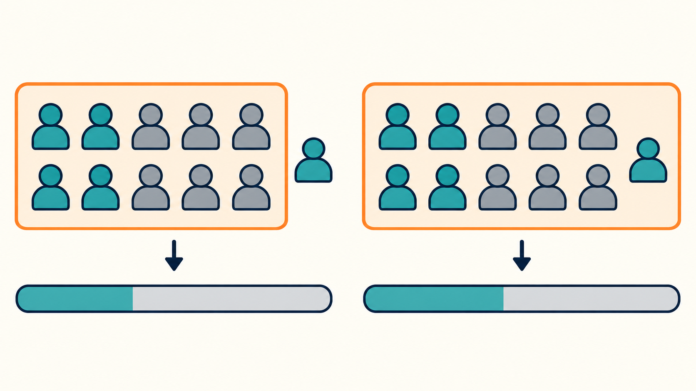
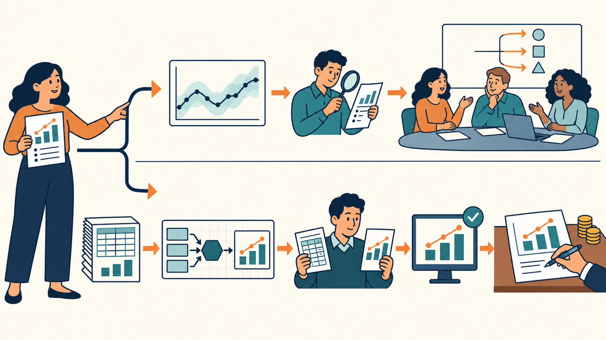

# AI가 내놓는 숫자는 모두 정확해야 할까요?

주간 보고에 넣을 비율을 AI에게 물었는데, 확인할 때마다 다른 숫자가 나온다면 어떨까요? 두 번째도, 세 번째도 답이 다르면 이렇게 생각하겠죠. “역시 AI는 못 믿겠다.” 하지만 AI의 실력을 탓하기 전에 살펴볼 것이 있습니다. 우리가 무엇을 계산하라고 했는지 말입니다.

앞선 대화를 보지 못하게 한 채 AI에게 같은 질문을 열 번 던진 실험이 있습니다. 최근 30일 동안 가입한 회원 중 광고 수신에 동의한 비율을 물었는데요, 답은 여섯 번 바뀌었습니다. 공개된 숫자는 각색된 값으로, 40%, 41%에서 44.5%, 45.7%까지 오갔죠.

왜 이런 일이 벌어졌을까요? 질문에 없는 조건을 AI가 매번 알아서 정했기 때문입니다. 탈퇴 대기 회원을 포함할지, 오늘을 넣을지, 언제부터 셀지에 따라 1~2%p가 달라졌습니다. 40%대 중반은 일별 동의율을 단순 평균한 값이었고, 40% 안팎은 일별 가입자 수를 반영한 평균이었습니다. 후자가 더 그럴듯하지만 전자를 무조건 틀렸다고 하기도 어렵죠. 여러분의 주간 보고 숫자가 바뀐 이유도 여기에 있을지 모릅니다.

그렇다면 동료 여럿에게 같은 질문을 던지면 답이 일치할까요? 기준이 불분명하면 사람도 조건을 빠뜨리거나 집계 방식을 달리 선택합니다. 사람의 차이는 비교하지 않아 묻히고, AI의 차이는 열 번만 돌려도 드러나는 것이죠. 지시를 길게 쓴다고 해결되는 것도 아닙니다. 결국 이런 흔들림을 고려해 팀의 업무 방식을 설계해야 합니다.

우리는 무엇 때문에 숫자를 찾을까요? 정답을 맞히기 위해서만은 아닙니다. 팀에서 무엇을 할지 결정하고 빨리 움직이기 위해서죠. 회의에서 새 안건을 검토하거나 시도해 볼 방향을 정하는 데 소수점까지 정확한 숫자가 꼭 필요할까요? 숫자를 얼마나 정확하게 확인할지는 그 숫자로 어떤 결정을 내릴지에 달려 있습니다.

물론 매출, 정산, 경영 보고에 들어갈 숫자는 다릅니다. 계산 기준을 미리 정하고 검증한 대시보드에서 가져와야 합니다. 토스는 고객 금융 데이터의 지표별 계산 규칙을 정하고 그 위에서 AI가 답하게 해, 데이터 질문에 맞게 답하는 비율을 24.7%에서 95%까지 높였다고 밝혔습니다. 모든 숫자에 이런 기준을 세울 수는 없으니, 틀렸을 때 문제가 생기는 숫자부터 공을 들여야겠죠.

그렇다고 오차를 받아들이자는 말을 확인을 생략해도 된다는 뜻으로 이해해서는 곤란합니다. AI를 써도 검증 부담은 사라지지 않습니다. 형태만 바뀔 뿐이죠. AI의 숫자를 회의에 올리려면 확인할 담당자부터 정해야 합니다. 어떤 조건으로 계산했는지 AI에게 되묻고, 대략적인 값임을 보고서에 명시하는 것까지 그 사람의 몫입니다.

AI 시대에 필요한 능력은 어떤 숫자가 정확해야 하는지 가려내는 능력입니다. 다음 주간 보고를 쓰기 전에 물어보기 바랍니다. “이 숫자가 틀리면 우리 팀의 어떤 결정이 잘못되는가?” 방향을 탐색하는 단계라면 AI의 대략적인 값으로 검토를 시작할 수 있습니다. 잘못된 결재로 이어진다면 처음부터 검증된 곳에서 가져와야 합니다. 숫자의 용도를 판단하는 일까지 AI에게 맡길 수는 없으니까요.
