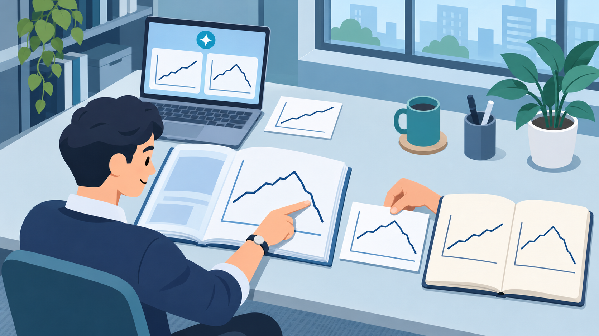

# AI가 요약해 줘도 판단력은 직접 길러야 합니다

다음 주 회의 자료를 AI로 요약해 읽었다고 해보죠. 주요 내용도 파악했고, 보고서의 분량과 논리도 흠잡을 데 없습니다. 그런데 리더가 “이 전망은 어떤 가정에 근거합니까? 그 가정이 깨지면 결론은 어떻게 됩니까?”라고 묻자 말이 막힙니다. 여러분은 자료를 이해한 걸까요?

핵심 내용을 아는 것과 결론에 이르는 과정을 이해하는 것은 다른 일입니다. AI가 읽고 정리하는 양이 늘어도 우리의 판단력까지 저절로 높아지지는 않으니까요.

하버드경영대학원의 샌드라 수처 교수는 수업에서 학생들이 읽고 쓰는 과정에 AI를 활용하지 못하도록 합니다. 사례 연구와 논문 대신 소포클레스의 희곡, 가즈오 이시구로의 소설 같은 작품을 읽히죠.

학생들은 작품에서 벌어진 일을 있는 그대로 묘사하고, 이해관계자들의 서로 다른 관점에서 사건을 분석합니다. 이 과정에서 미처 생각하지 못한 인사이트를 발견하고, 판단의 근거를 세우며 자기 생각에 빈틈은 없는지 살펴봅니다. 요약만 읽으면 이런 사고 과정을 온전히 경험하기 어렵습니다.

그렇다고 AI의 요약 기능을 쓰지 말자는 뜻은 아닙니다. 먼저 원자료를 읽고 잠시 덮은 뒤, 내용을 잘 모르는 동료에게 설명한다고 생각해 보세요. 자기 말로 설명하다 막힌다면 그 부분을 다시 살펴봐야 합니다.

원자료를 확인했다면 해결하려는 문제와 잠정적인 답, 판단의 근거를 몇 줄 적어 보세요. 이어 AI에게 자신의 판단에서 놓친 점이나 허점이 없는지 물어보는 겁니다. AI의 지적은 원자료와 대조하고, 제안을 수용하거나 받아들이지 않은 이유도 짧게 남겨 두기 바랍니다.

이렇게 AI의 지적을 검토하려면 사업을 이해하는 전문성과 근거를 따지는 비판적 사고가 필요합니다. 2026년 이천포럼 타운홀미팅에서는 AI가 그럴듯한 오답을 내놓을 수 있으며, 이를 가려내는 힘은 각자의 사업 전문성에서 나온다는 언급이 있었습니다. AI의 시나리오를 따지는 비판적 사고와 적기에 밀어붙이는 패기를 Up-skilling의 축으로 짚었죠. 진단과 교육이 업무에서 직접 이해하고 판단하는 연습으로 이어질 때, AI의 답을 검토하는 힘도 키울 수 있습니다.

다음 보고 전에는 스스로 내린 결론을 놓고 물어보세요. “이 결론은 어떤 가정에 근거하고, 무엇이 바뀌면 수정해야 할까?” 바로 답이 나오지 않아도 좋습니다. 회의실에 들어가기 전에, 어디를 더 살펴봐야 할지 알게 된 것이니까요.
